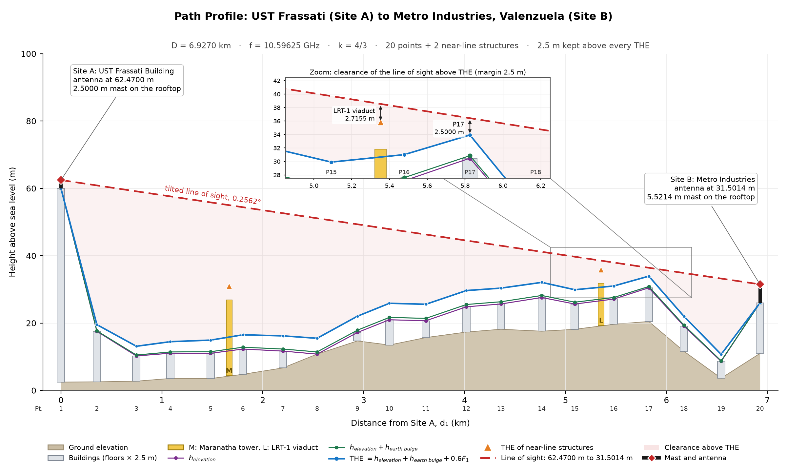

# TRANSMA Project: ECE21129 Microwave Link Design (4ECE-B, Group 5)

A 10.59625 GHz point-to-point microwave link from the UST Frassati Building (Site A) to Metro Industries, 84 Ramon Delfin St, Marulas, Valenzuela (Site B). Due **November 27, 2026**.

Start with **[WHERE_WE_LEFT_OFF.md](WHERE_WE_LEFT_OFF.md)**. It has the current numbers, the open tasks, and how to rerun everything.

## Current design at a glance

| Item | Value |
|---|---|
| Path length | 6.9270 km |
| Antenna heights A / B (tilted, 2.5 m safety margin above THE) | 62.4700 m / 31.5014 m |
| Towers A / B | 2.5000 m / 5.5214 m (flat method would need 36.4900 m) |
| Tilt | 0.2562° |
| RSL at amplifier output (Section 3 draft) | 12.0568 dBm |
| Fade margin (Section 3 draft) | 109.8546 dB |

## Folders

| Folder | What is inside |
|---|---|
| `report/` | Report files. **`4ECEB_Group5_Report_Metro_Section2.docx`** is the group's latest export with Section 2 filled for Metro Industries (2.5 m margin). `Section2_Metro_Text.md` is the Section 2 text for pasting into Google Docs; `Section2_Metro_Industries.md` is the same with figures. **`4ECEB_Group5_Section2_Task_Distribution.docx`** has the checklist, each member's handwritten solutions to copy (every value in Tables 2, 3 and 4 plus the clearance check), and space for the scans. `4ECEB_Group5_Report_group_latest_export.docx` is the base the Section 2 builder starts from. Also the `.mat` deliverable. The old Fini Homes drafts were removed (still in git history) |
| `figures/` | Map, pattern overlay, path profile, and MATLAB pattern images. `_M` = Metro Industries (current), `_A` = Frassati to Fini (old Option A), `_B` = BGPOP to Fini (old Option B) |
| `specs/` | Specification sheet images for the appendix (antenna, adapters, amplifiers, fiber) |
| `notes/` | AI use log, Option A vs B comparison, guideline rules, project setup, and site-selection history |
| `work/` | Python scripts, point data, results JSON, and the MATLAB simulation (`work/matlab/sim_antenna.m`). `section2_path_profile.py` draws the path profile on its own (only needs matplotlib) |
